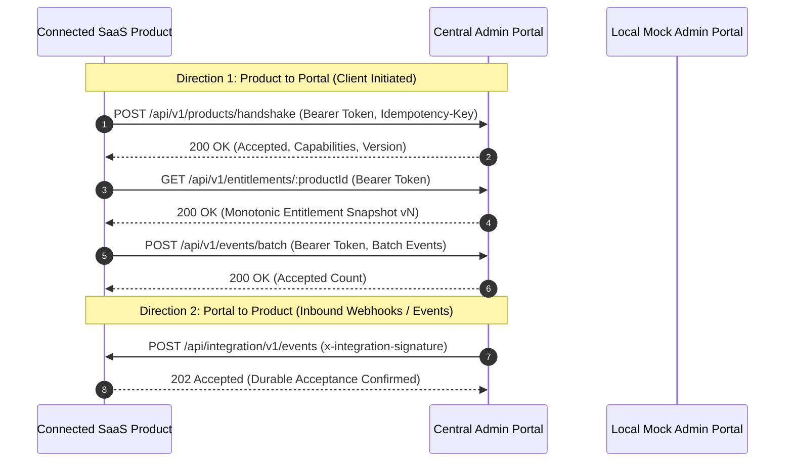

# SaaS Admin Portal Integration Architecture (SAAS_INTEGRATION.md)

This document specifies the communication contract, authentication mechanisms, and integration interfaces between products generated from this template and the centralized Admin Portal control plane.

---

## 1. Architectural Overview and Communication Topology

Every SaaS product generated from this template (including Tracker, Namer, Stremora, Booker, and future SaaS applications) integrates with the central Admin Portal using standardized, versioned contracts.



---

## 2. Integration API Contract and Versioning

- **Current Contract Version**: `2026-10-01`
- **Location**: `lib/saas-integration/`
  - `types.ts`: TypeScript interfaces for manifests, events, snapshots, and capabilities.
  - `contract.ts`: Runtime Zod schemas validating all inbound and outbound payloads.
  - `auth.ts`: Cryptographic HMAC-SHA256 signature generation and verification.
  - `entitlements.ts`: Monotonic version cache with outage grace handling.
  - `client.ts`: Resilient server-side client with bounded retries, jitter, and normalized errors.
  - `mock-portal.ts`: In-memory development and test harness simulating the central control plane.

---

## 3. Product Manifest Specification

The product manifest describes the product's identity, version, environment, declared capabilities, and configurable feature limits.

### Sample Manifest (`GET /api/integration/v1/manifest`)

```json
{
  "schemaVersion": "1.0.0",
  "productId": "tracker-app",
  "name": "Tracker Life Dashboard",
  "version": "1.0.0",
  "integrationApiVersion": "2026-10-01",
  "environment": "development",
  "capabilities": ["health.read", "events.write", "entitlements.read"],
  "features": {
    "export_csv": {
      "type": "boolean",
      "defaultValue": false,
      "description": "Allows CSV export of personal tracking data"
    },
    "max_projects": {
      "type": "number",
      "defaultValue": 3,
      "description": "Maximum number of concurrent projects allowed"
    }
  }
}
```

### Supported Capabilities

- `health.read`: Exposes diagnostic readiness and liveness to portal probes.
- `events.write`: Submits product lifecycle, audit, and usage events to the portal.
- `entitlements.read`: Queries subscription-derived feature access and usage limits.
- `usage.write`: Periodically reports metered consumption metrics.
- `commands.receive`: Enables gated, authenticated portal-to-product commands.

---

## 4. Service-to-Service Security and Authentication

Two distinct authentication trust directions are enforced:

### Direction A: Admin Portal to Product (Inbound)

1. The Admin Portal signs the exact raw request body using HMAC-SHA256.
2. The signature is transmitted via the `x-integration-signature` header:
   `t=1776510000,v1=5f2d...`
3. The product verifies:
   - Header formatting and presence of timestamp and digest.
   - Clock skew within 300 seconds (5 minutes).
   - Replay protection: seen digests within the skew window are cached and rejected if replayed.
   - Constant-time verification using `crypto.timingSafeEqual`.

### Direction B: Product to Admin Portal (Outbound)

1. The product provides its scoped client credentials:
   - `x-integration-client-id`: Declared product identifier.
   - `Authorization: Bearer <ADMIN_PORTAL_CLIENT_SECRET>`
2. All writes supply an `x-idempotency-key` header to ensure safe retries on network dropouts.
3. Requests include `x-correlation-id` for distributed tracing.

---

## 5. Entitlement Synchronization and Outage Policy

The Admin Portal is the authoritative source for subscription plans and entitlements. Products must not grant unauthorized access when the portal is unreachable.

### Monotonic Versioning

Entitlement snapshots are versioned monotonically with non-negative integers (`v1, v2, v3...`). If an update is received with a version lower than the current local version, it is rejected and logged as stale.

### Outage Grace Policy

- **Default Mode**: If the local snapshot expires during a portal outage, a configurable grace period (default: 24 hours) allows existing authenticated users to continue working without disruption.
- **Strict Mode**: If `strictMode: true` is configured, expired entitlements fail closed immediately.
- **Revocations**: Account suspensions or security freezes are distinct from plan downgrades and are enforced immediately upon notification.

---

## 6. Product-Side Integration Endpoints

| Endpoint                           | Method | Direction | Purpose                                         | Authentication            |
| :--------------------------------- | :----- | :-------- | :---------------------------------------------- | :------------------------ |
| `/api/integration/v1/manifest`     | GET    | Inbound   | Returns product manifest and declared limits    | None (Public metadata)    |
| `/api/integration/v1/health`       | GET    | Inbound   | Probes integration liveness and readiness       | None (Safe diagnostic)    |
| `/api/integration/v1/capabilities` | GET    | Inbound   | Discloses supported capabilities                | None (Public metadata)    |
| `/api/integration/v1/events`       | POST   | Inbound   | Ingests verified events or webhooks from portal | `x-integration-signature` |

---

## 7. Local Testing with Mock Admin Portal

Before the centralized Admin Portal is deployed, products test integration locally using `MockAdminPortal`:

```typescript
import { AdminPortalClient, MockAdminPortal, createDefaultManifest } from "@/lib/saas-integration";

const mockPortal = new MockAdminPortal();

const client = new AdminPortalClient({
  baseUrl: "http://mock-portal.local",
  clientId: "local-product",
  clientSecret: "mock_secret",
  transport: mockPortal.getTransport(), // In-memory, zero network latency
});

// Perform handshake
const response = await client.registerOrHandshake(createDefaultManifest());
console.log("Handshake accepted:", response.accepted);
```
